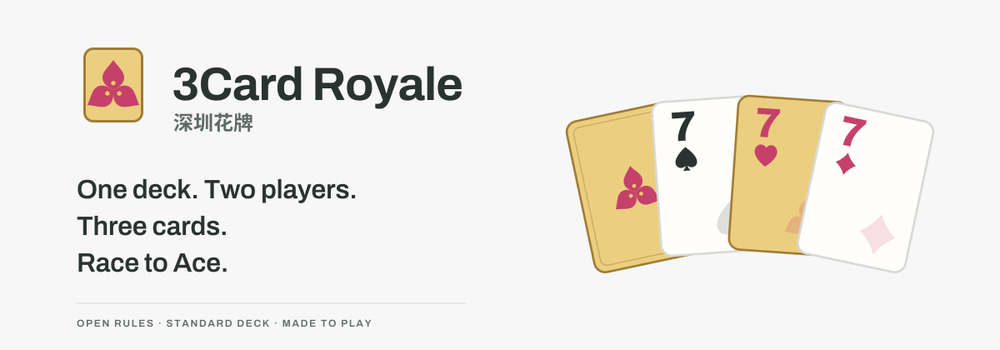

# 3Card Royale · 深圳花牌

[English](README.md) · [简体中文](README.zh-CN.md) · [日本語](README.ja.md) · [한국어](README.ko.md) · **Español**



**Una baraja. Dos personas. Tres cartas. Hazlas florecer.**

3Card Royale, también llamado **Shenzhen Flower Cards**, es un juego de cartas para dos nacido en Shenzhen. Forma combinaciones con tu mano y tus heridas visibles y avanza del 2 al As. Juega con una baraja normal de 52 cartas o desafía a una IA en el navegador.

[**Jugar ↗**](https://lucienzhu.github.io/3card-royale/?lang=es) · [Aprender](https://lucienzhu.github.io/3card-royale/about.html?lang=es) · [Identidad](https://lucienzhu.github.io/3card-royale/brand.html?lang=es) · [Arena de IA](https://lucienzhu.github.io/3card-royale/arena.html?lang=es)

El sitio, la práctica, las reglas y las imágenes para compartir están disponibles en español, inglés, chino, japonés y coreano.

## El juego

1. Empieza con ocho cartas. Combina cartas de tu mano y de tus heridas para jugar tres; solo puedes jugar cuatro o cinco si forman póquer o repóquer.
2. Gana un ataque para causar heridas. Gana una defensa para obtener intercambios opcionales. Un empate exacto no produce efectos.
3. Cambiad los papeles. Tras un ataque de cada jugador, conservad las cartas restantes y reponed la mano hasta ocho.

Con cinco heridas pierdes el juego. El ganador sube tantos niveles como la diferencia final de heridas. Llega al As y gana tu propio juego de As como titular del nivel para ganar el encuentro. Usar una herida no cura: su carta se repone después. Ambos jugadores comparten un comodín de corazones durante cada juego.

[Reglas estándar 1.0.0](docs/RULES.es.md) · [Reglas A4 en PDF](docs/shenzhen-flower-rules-a4.es.pdf)

Incluye una práctica breve de ataque y defensa, pistas para el primer juego, selección táctil, repeticiones e imágenes PNG para compartir. El resumen de un juego y la celebración del encuentro tienen diseños distintos. Las semillas y los registros permiten reproducir una partida.

## IA e investigación

Elige en **Ajustes → Preferencias → Rival de IA**. El valor inicial es Easy. NN AI ejecuta el modelo autorregresivo en un Worker; Arena AI también ofrece modelos que puntúan jugadas completas. Godlike puede ver la mano actual del rival, por lo que queda fuera de la clasificación de información pública.

Código, puntuación de jugadas completas y redes autorregresivas usan **un único protocolo de acciones**: identificadores fijos de cartas, acciones semánticas completas y una serialización opcional de seis tokens. GameCore valida y aplica cada acción completa una sola vez.

| Política neuronal | Capas ocultas | Parámetros | ONNX | Victorias frente a Code AI |
| --- | --- | ---: | ---: | ---: |
| Puntuación de jugadas completas | 256 → 128 | 137.729 | 0,55 MB | 42,6 % |
| Autorregresiva | 256 → 128 | 228.929 | 0,92 MB | 23,9 % |

Ambas son referencias de clonación de comportamiento, entrenadas en PyTorch con conjuntos separados de 10.000 juegos de SDK Code AI, con curvas de TensorBoard y exportación ONNX. SDK Code AI es el profesor congelado; Code AI del navegador es el rival Hard. La tabla usa 1.000 juegos por pareja sobre las mismas semillas, intercambiando asientos y equilibrando quién empieza. No son modelos RL entrenados con recompensas, ni los nombres de dificultad representan un orden de fuerza demostrado.

- [Guía técnica: SDK, acciones y Gym](docs/GUIDE.es.md)
- [Modelos y evaluación](docs/GUIDE.es.md#models) · [Evaluación completa (inglés)](docs/experiments/complete-baseline/README.md)
- [Entrenamiento y reproducción](docs/GUIDE.es.md#training) · [Enviar una política JS / ONNX](docs/GUIDE.es.md#arena)

Cada envío incluye el usuario de GitHub y hashes de archivos inmutables. La validación local y el CI de las PR comprueban que puede jugar. Al publicar una versión, se evalúan las políticas pendientes contra tres referencias fijas y se actualizan la clasificación y Pages. Cada envío requiere 60 juegos puntuados y cuatro de validación.

## Ejecución local

El sitio es estático e incluye el entorno de inferencia.

```sh
python3 -m http.server 8000 --bind 127.0.0.1
# http://127.0.0.1:8000/about.html?lang=es
npm ci
npm test
```

El SDK incluye JavaScript / TypeScript, Python, Rust y C++17. Gym admite juegos individuales y encuentros completos. Consulta [desarrollo y validación](docs/GUIDE.es.md#contribute).

## Diseño y licencia

La buganvilla, flor de Shenzhen, las flores rojas y el verde de las placas de circuito definen la identidad. La flor de tres brácteas, la carta dorada y los símbolos de los jugadores comparten recursos entre el juego, el sitio y las exportaciones.

[Especificación de diseño (inglés)](docs/DESIGN.md) · [Componentes](https://lucienzhu.github.io/3card-royale/design-system.html?lang=es) · [Comentarios](https://github.com/lucienzhu/3card-royale/issues/new/choose)

La versión de producto 1.2 y las reglas estándar 1.0.0 tienen numeraciones separadas. Código, reglas e ilustraciones originales usan la [licencia MIT](LICENSE).
