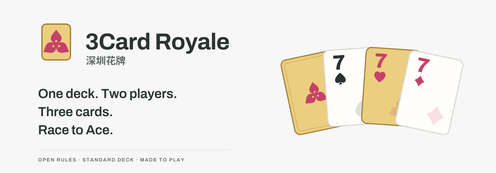

# 3Card Royale · 深圳花牌

[English](README.md) · [简体中文](README.zh-CN.md) · **日本語** · [한국어](README.ko.md) · [Español](README.es.md)



**ひと組のトランプ。ふたり。3枚で、花を咲かせよう。**

3Card Royale（別名 **Shenzhen Flower Cards**）は深圳生まれの2人用カードゲームです。手札と公開ダメージカードで役を作り、2からAへ。普通のトランプ52枚で遊ぶことも、ブラウザーでAIに挑むこともできます。

[**プレイ ↗**](https://lucienzhu.github.io/3card-royale/?lang=ja) · [遊び方](https://lucienzhu.github.io/3card-royale/about.html?lang=ja) · [ビジュアル](https://lucienzhu.github.io/3card-royale/brand.html?lang=ja) · [AIアリーナ](https://lucienzhu.github.io/3card-royale/arena.html?lang=ja)

サイト、練習、ルール、共有画像は、日本語・英語・中国語・韓国語・スペイン語に対応しています。

## 遊び方

1. 手札は8枚。自分の手札とダメージカードから3枚を選びます。4枚・5枚を出せるのはフォーカード・ファイブカードだけです。
2. 攻撃で勝てば相手にダメージ。防御で勝てば任意の交換機会。完全な引き分けなら何も起きません。
3. 攻守を交代。両者が1回ずつ攻撃したら、残った手札を保ち、8枚まで補充します。

5ダメージでそのゲームに敗北。勝者は最終ダメージ差だけ昇級します。Aに到達し、レベル担当として自分のAゲームに勝つとマッチ勝利です。ダメージカードは使った後で補充されるため、使っても回復しません。各ゲームで両者共通のハートのワイルドカードを使います。

[標準ルール 1.0.0](docs/RULES.ja.md) · [A4ルール PDF](docs/shenzhen-flower-rules-a4.ja.pdf)

短い攻撃・防御の練習、初戦のヒント、タッチ選択、リプレイ、PNG共有に対応。単独ゲームの振り返りとマッチ勝利の開花演出を分けています。シードと記録から対局を再現できます。

## AIと研究

**設定 → 環境設定 → AI対戦相手**で選択します。初期設定はEasy。NN AIは自己回帰モデルをWorker内で実行し、Arena AIでは手全体を評価するモデルも選べます。Godlikeは相手の現在の手札を見られるため、公開情報のランキングには参加しません。

コード、手全体のスコアリング、自己回帰モデルは**同じアクションプロトコル**を使います。固定カードIDを持つ完全な行動を返し、必要なら6トークンで直列化します。GameCoreは行動全体を検証し、一度だけ適用します。

| 方策 | 隠れ層 | パラメーター | ONNX | Code AIへの勝率 |
| --- | --- | ---: | ---: | ---: |
| 手全体のスコアリング | 256 → 128 | 137,729 | 0.55 MB | 42.6% |
| 自己回帰 | 256 → 128 | 228,929 | 0.92 MB | 23.9% |

両モデルは別々の10,000ゲーム分のSDK Code AIデータから、PyTorchで行動模倣学習したベースラインです。TensorBoardとONNX出力を含みます。凍結した教師のSDK Code AIと、ブラウザーのHardであるCode AIは異なります。表は同じシード群で各組1,000ゲーム、席を交換し先攻を均等化した結果です。報酬から学習したRLモデルではなく、難易度名も実測順位を意味しません。

- [技術ガイド：SDK・アクション・Gym](docs/GUIDE.ja.md)
- [モデルと評価](docs/GUIDE.ja.md#models) · [全評価記録（英語）](docs/experiments/complete-baseline/README.md)
- [学習と再現](docs/GUIDE.ja.md#training) · [JS / ONNX方策の投稿](docs/GUIDE.ja.md#arena)

投稿にはGitHubハンドルと変更不可の成果物ハッシュを付けます。ローカル検証とPR CIは対戦できることを確認。リリース時に未評価の方策を3つの固定基準と対戦させ、ランキングとPagesを更新します。投稿ごとに評価60ゲームと検証4ゲームです。

## ローカルで実行

静的サイトです。推論ランタイムもリポジトリに含まれます。

```sh
python3 -m http.server 8000 --bind 127.0.0.1
# http://127.0.0.1:8000/about.html?lang=ja
npm ci
npm test
```

SDKはJavaScript / TypeScript、Python、Rust、C++17に対応。Gymでは単独ゲームとマッチ全体を扱えます。[開発・検証](docs/GUIDE.ja.md#contribute)をご覧ください。

## デザインとライセンス

深圳の市花ブーゲンビリア、赤い花、回路基板の緑がアイデンティティの原点です。3枚の苞を持つ花、金色のカード、プレイヤーマークは、ゲーム・サイト・出力で共通のアセットを使います。

[デザイン仕様（英語）](docs/DESIGN.md) · [コンポーネント](https://lucienzhu.github.io/3card-royale/design-system.html?lang=ja) · [フィードバック](https://github.com/lucienzhu/3card-royale/issues/new/choose)

製品1.2と標準ルール1.0.0は別のバージョン番号です。コード、ルール、オリジナルアートは[MITライセンス](LICENSE)です。
