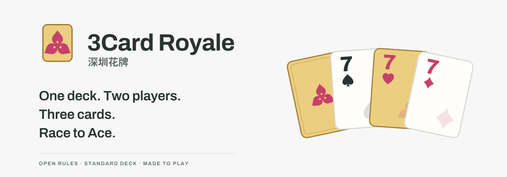

# 3Card Royale · 深圳花牌

[English](README.md) · [简体中文](README.zh-CN.md) · [日本語](README.ja.md) · **한국어** · [Español](README.es.md)



**카드 한 벌. 두 사람. 세 장으로 꽃을 피우세요.**

3Card Royale, 별칭 **Shenzhen Flower Cards**는 선전에서 탄생한 2인용 카드 게임입니다. 손패와 공개 피해 카드로 족보를 만들고 2에서 A까지 올라가세요. 일반 트럼프 52장으로 플레이하거나 브라우저에서 AI에 도전할 수 있습니다.

[**플레이 ↗**](https://lucienzhu.github.io/3card-royale/?lang=ko) · [게임 방법](https://lucienzhu.github.io/3card-royale/about.html?lang=ko) · [아이덴티티](https://lucienzhu.github.io/3card-royale/brand.html?lang=ko) · [AI 아레나](https://lucienzhu.github.io/3card-royale/arena.html?lang=ko)

사이트, 연습, 규칙, 공유 이미지를 한국어·영어·중국어·일본어·스페인어로 제공합니다.

## 게임 방법

1. 손패 8장으로 시작합니다. 자신의 손패와 피해 카드에서 3장을 고릅니다. 4장은 포카드, 5장은 파이브카드만 낼 수 있습니다.
2. 공격에서 이기면 피해를 주고, 방어에서 이기면 선택 가능한 교환 기회를 얻습니다. 완전 동률이면 아무 효과도 없습니다.
3. 공격과 방어를 바꿉니다. 양쪽이 한 번씩 공격하면 남은 손패를 유지하고 8장까지 보충합니다.

피해 5에 도달하면 해당 게임에서 집니다. 승자는 최종 피해 차만큼 승급합니다. A에 도달한 뒤 레벨 주인으로 자신의 A 게임을 이겨야 매치에서 승리합니다. 피해 카드를 사용한 자리는 다시 채워지므로 회복되지 않습니다. 각 게임에서 두 플레이어는 하나의 하트 와일드카드를 공유합니다.

[표준 규칙 1.0.0](docs/RULES.ko.md) · [A4 규칙 PDF](docs/shenzhen-flower-rules-a4.ko.pdf)

짧은 공격·방어 연습, 첫 게임 힌트, 터치 선택, 리플레이, PNG 공유를 제공합니다. 개별 게임 회고와 전체 매치의 개화 연출은 구분됩니다. 시드와 기록으로 대국을 재현할 수 있습니다.

## AI와 연구

**설정 → 환경설정 → AI 상대**에서 선택하세요. 기본값은 Easy입니다. NN AI는 Worker에서 자기회귀 체크포인트를 실행하며, Arena AI에서는 전체 수를 평가하는 모델도 선택할 수 있습니다. Godlike는 상대의 현재 손패를 볼 수 있으므로 공개 정보 순위에서 제외됩니다.

코드, 전체 수 점수화, 자기회귀 모델은 **하나의 액션 프로토콜**을 사용합니다. 고정 카드 ID로 완성된 행동을 반환하며, 필요하면 6개 토큰으로 직렬화합니다. GameCore는 행동 전체를 검증한 뒤 한 번만 적용합니다.

| 정책 | 은닉층 | 파라미터 | ONNX | Code AI 상대 승률 |
| --- | --- | ---: | ---: | ---: |
| 전체 수 점수화 | 256 → 128 | 137,729 | 0.55 MB | 42.6% |
| 자기회귀 | 256 → 128 | 228,929 | 0.92 MB | 23.9% |

두 모델은 각각 별도의 SDK Code AI 10,000게임 데이터로 PyTorch 행동 복제 학습을 한 기준 모델입니다. TensorBoard 곡선과 ONNX 내보내기를 제공합니다. 고정된 학습 교사 SDK Code AI와 브라우저의 어려움 상대 Code AI는 다릅니다. 표는 동일한 시드 집합, 좌석 교환, 균형 잡힌 선공으로 조합당 1,000게임을 평가한 결과입니다. 보상으로 학습한 RL 모델이 아니며, 난이도 이름도 실측 실력 순위를 뜻하지 않습니다.

- [기술 가이드: SDK·액션·Gym](docs/GUIDE.ko.md)
- [모델과 평가](docs/GUIDE.ko.md#models) · [전체 평가 기록(영어)](docs/experiments/complete-baseline/README.md)
- [학습과 재현](docs/GUIDE.ko.md#training) · [JS / ONNX 정책 제출](docs/GUIDE.ko.md#arena)

제출에는 GitHub 핸들과 변경 불가한 산출물 해시가 포함됩니다. 로컬 검증과 PR CI는 대전 가능 여부를 확인합니다. 릴리스할 때 미평가 정책을 고정 기준 3개와 대전시켜 순위와 Pages를 갱신합니다. 제출당 평가 60게임과 검증 4게임입니다.

## 로컬 실행

정적 사이트이며 추론 런타임도 저장소에 포함됩니다.

```sh
python3 -m http.server 8000 --bind 127.0.0.1
# http://127.0.0.1:8000/about.html?lang=ko
npm ci
npm test
```

SDK는 JavaScript / TypeScript, Python, Rust, C++17을 지원합니다. Gym은 개별 게임과 전체 매치 작업을 제공합니다. [개발 및 검증](docs/GUIDE.ko.md#contribute)을 참고하세요.

## 디자인과 라이선스

선전의 시화 부겐빌레아, 붉은 꽃, 회로기판의 녹색에서 아이덴티티를 가져왔습니다. 세 포엽의 꽃, 금색 카드, 플레이어 표시는 게임·사이트·내보내기에서 같은 에셋을 사용합니다.

[디자인 명세(영어)](docs/DESIGN.md) · [컴포넌트](https://lucienzhu.github.io/3card-royale/design-system.html?lang=ko) · [피드백](https://github.com/lucienzhu/3card-royale/issues/new/choose)

제품 1.2와 표준 규칙 1.0.0은 별도의 버전 번호입니다. 코드, 규칙, 원본 아트에는 [MIT 라이선스](LICENSE)가 적용됩니다.
