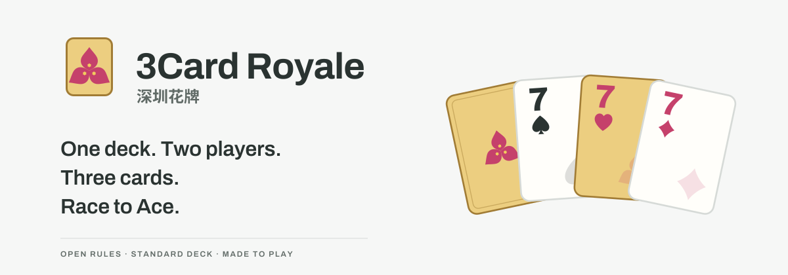

# 3Card Royale · 深圳花牌

[简体中文](README.zh-CN.md) · **English**



**One deck. Two players. Three cards. Make them bloom.**

3Card Royale, aka **Shenzhen Flower Cards**, is a two-player card game from Shenzhen. Build hands, turn wounds into playable options, and race from 2 to Ace. Play with a standard 52-card deck or challenge an AI in your browser.

[**Play ↗**](https://lucienzhu.github.io/3card-royale/?lang=en) · [Learn](https://lucienzhu.github.io/3card-royale/about.html?lang=en) · [Identity](https://lucienzhu.github.io/3card-royale/brand.html?lang=en) · [AI Arena](https://lucienzhu.github.io/3card-royale/arena.html?lang=en)

## The game

1. Start with eight cards. Combine private hand cards and public wound cards to play three; four- and five-card plays must be bombs.
2. Win an attack to deal wounds. Win a defense to earn optional swaps. An exact tie does nothing.
3. Exchange roles. After both players have attacked, keep unused cards and refill to eight.

Five wounds lose the game. The winner advances by the final wound difference. Reach Ace, then win your own Ace game to win the match. Playing a wound replaces it afterward; it does not heal you. Both players share one heart wildcard for each game.

[Standard rules 1.0.0](docs/RULES.md) · [Printable rules](https://lucienzhu.github.io/3card-royale/about.html?lang=en#learn)

The playtest includes a short attack/defense practice, first-game hints, touch selection, replays and PNG result cards. Single-game recaps and full-match celebrations have distinct layouts. Seeds and records let you reproduce a game.

## AI and research

Choose an opponent in **Settings → Preferences → AI opponent**. New players start on Easy. NN AI runs the autoregressive checkpoint locally in a Worker; Arena AI also offers the whole-move scorers. Godlike can see the rival's current hand and is excluded from the public-information ladder.

Code policies, whole-move scoring and autoregressive networks share **one action protocol**: fixed card IDs, complete semantic moves and optional six-token serialization. GameCore validates and applies each complete move once. Network architecture is a policy choice.

| Neural policy | Hidden layers | Parameters | ONNX | Wins vs Code AI |
| --- | --- | ---: | ---: | ---: |
| Whole-move scoring | 256 → 128 | 137,729 | 0.55 MB | 42.6% |
| Autoregressive | 256 → 128 | 228,929 | 0.92 MB | 23.9% |

Both are behavioral-cloning baselines trained with PyTorch from separate 10,000-game SDK Code AI datasets, with TensorBoard curves and ONNX exports. SDK Code AI is the frozen teacher; browser Code AI is the Hard opponent. The table uses 1,000 games per pairing on the same seeds, exchanged seats and balanced first movers. These checkpoints are not reward-trained RL models, and difficulty labels are not a measured strength ordering.

- [Action protocol and Gym](docs/ACTIONS.md) · [RL environment](docs/RL.md)
- [Models and evidence](docs/MODEL.md) · [Complete benchmark](docs/experiments/complete-baseline/README.md)
- Training: [whole-move scoring](training/README.md) · [autoregressive](training/structured/README.md)
- [Submit a JS or ONNX policy](policies/README.md) · [Rating method](arena/README.md)

Arena submissions carry a GitHub author handle and immutable artifact checksums. Local validation and PR CI check playability. Release evaluation rates pending submissions against three fixed references, then updates the leaderboard and Pages. Each submission costs 60 rated games plus four validation games.

## Run locally

The site is static; the inference runtime is vendored.

```sh
python3 -m http.server 8000 --bind 127.0.0.1
# Open http://127.0.0.1:8000/about.html?lang=en
npm ci
npm test
```

The portable SDK includes JavaScript/TypeScript, Python, Rust and C++17. Gym adds individual-game and full-match tasks. See [SDK setup](docs/SDK.md), [contributing](docs/CONTRIBUTING.md) and [gametest evidence](docs/GAMETEST.md).

## Design and license

Shenzhen's bougainvillea, red flowers and circuit-board green shape the identity. The original three-bract flower, gold card and player marks share canonical assets across the game, site and exports.

[Design specification](docs/DESIGN.md) · [Live components](https://lucienzhu.github.io/3card-royale/design-system.html?lang=en) · [Feedback](https://github.com/lucienzhu/3card-royale/issues/new/choose)

Product release 1.2 and Standard rules 1.0.0 are separate version numbers. Code, rules and original artwork use the [MIT license](LICENSE).
