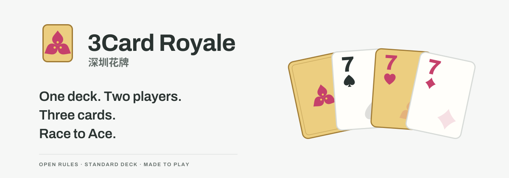

# 3Card Royale · 深圳花牌

[简体中文](README.zh-CN.md) · **English**



**One standard deck. Two players. Race from 2 to Ace.**

An open card game from Shenzhen: build three-card hands, turn wounds into playable options, and earn swaps by defending well. Four of a kind scores 6; the rare four naturals plus flower form five of a kind for 7.

[**Play in English ↗**](https://lucienzhu.github.io/3card-royale/?lang=en) · [Learn the game](https://lucienzhu.github.io/3card-royale/about.html?lang=en) · [Read the rules](docs/RULES.md) · [Visual identity](https://lucienzhu.github.io/3card-royale/brand.html?lang=en)

The browser demo plays against the computer. For two people at a table, all you need is a standard 52-card deck. No sign-in, betting, or cash conversion.


The demo menu shows the match seed and the current game’s deal seed. New matches use random seeds by default; select Fixed seed to reproduce a match with the same rules, opening setting and actions. The match seed stays fixed while games continue along its random stream, rather than reshuffling from the same seed every game.

## How a round works

1. Make a three-card hand from your private hand and your face-up wounds. Four of a kind uses four; five of a kind uses five.
2. Attack wins deal damage. Defense wins earn card swaps. An exact tie does nothing.
3. Swap roles without refilling. After each player has attacked once, keep your unused cards and refill to eight.

At five wounds you lose the game. The winner levels up by the complete final damage gap and attacks first next game. Reach A, then win your own Ace game: you must own that game’s level and the shared flower must be ♥A. Winning a rival’s level-10 game while personally at Ace only earns your own Ace game next; losing that defense does not count as a failed Ace challenge.

## What makes it different

- **Wounds are options.** You may play them, but replace them afterward: using a wound does not heal it.
- **Defense changes your next hand.** Swap your hand or wound cards with a rival’s cards, your other card zone, or the draw pile.
- **One shared flower.** A heart wildcard follows the previous winner’s new level. Both players share it for the whole game.

## Run locally

No build step is needed. The optional NN AI runtime is already vendored. Serve the repository with any static HTTP server. For example:

```sh
python3 -m http.server 8000 --bind 127.0.0.1
# Open http://127.0.0.1:8000/about.html?lang=en
```

With Node.js installed, run the repository checks:

```sh
node scripts/check.cjs
```

## Explore and contribute

| Resource | Start here |
| --- | --- |
| Rules | [Full 1.0.0 rulebook](docs/RULES.md) |
| Contributing | [Local development, structure, feedback and translations](docs/CONTRIBUTING.md) |
| Design | [Specification](docs/DESIGN.md) · [Live components](https://lucienzhu.github.io/3card-royale/design-system.html?lang=en) |
| Feedback | [Playtest notes and bug reports](https://github.com/lucienzhu/3card-royale/issues/new/choose) |
| Research | [Historical three-card probability lab](https://lucienzhu.github.io/3card-royale/probability.html?lang=en) |

**Status:** playtest rules 1.0.0. Rules are still being tested with people; simulation results are not a claim of balance or popularity. Older rule variants remain selectable in the game menu, and release tags are immutable.

## License

Code, rule text and original visual assets are released under the [MIT license](LICENSE). Keep the copyright and license notice. You are welcome to play, adapt, translate and build your own implementation; identify rule changes and avoid presenting a fork as the original project.

## Build with the game

SDK 0.2.0 / rules 1.0.0: JavaScript + TypeScript types, native Python, Rust and C++17 share card IDs, actions and a JSON state format. A visible-information strategy opponent and optional Gymnasium environment are included.

- [Portable SDK and examples](docs/SDK.md)
- [RL environment, masks and observations](docs/RL.md)
- [C++ source & CMake](cpp/) · [Python source](python/threecard_royale/) · [Rust source](rust/) · [JavaScript API](sdk/)

`python -m pip install -e './python[gym]'`, then `python examples/train_random.py`. Build Rust with `cargo build --manifest-path rust/Cargo.toml --locked`. These are source distributions; no registry package has been published.

## Why the name?

**Three cards at the core. Bougainvillea at the heart.** Shenzhen gives the game its home and flower; Hanafuda, Zha Jin Hua, Guandan and Balatro inspire the fusion of combinations, visible-card choices, swapping and progression. The goal is simple: make one ordinary deck as fun as it can be for two people. The standard 52-card deck still has no jokers.

Standard 1.0 adds five of a kind (7 points): four natural equal-rank cards plus the shared flower. See [complete standard rules](docs/RULES.md). Five-card plays are included in legal actions. `wild.as` is a virtual face; in five of a kind it may name an already-present representative face without reusing a physical card. Gym score/kind features use /7 and played-card count uses /5.

## Match flowers

The shared red/gold progress vine now follows the actual game results. Tap it for a game-by-game recap. Passing your own Ace blooms across the Shenzhen skyline in the winner’s color; replaying the animation never changes the game, cards, seed or saved results.

A single-game win stays in a compact result panel. The final match result fills the screen: the winner's first three played cards flip to gold backs, bloom, and drift into the city. The match PNG uses the same flower composition, with red for you and gold for your rival. Reduced motion shows the completed scene directly.

## PNG result cards

Choose Share PNG after a game or match to preview and save a PNG. On supported devices, the preview can open the system share sheet with the PNG alone and no caption; devices that cannot share images share the game link instead. To send it to a WeChat friend, choose Copy image and paste it into the chat: on iPhone the share sheet hands WeChat a file, and WeChat’s Send to Friend never opens the friend list for it. After a game, Review & share offers three PNGs: Game recap includes every recorded combat in chronological order as a scrolling long PNG; Final hand shows the last plays and public wound racks with the final wound gap; Best play can select the biggest hit or highest-scoring hand. Each recap combat is one row with attack on the left and defense on the right; flower marks identify the players. Final hand and Best play keep the gold-flower rival above the red-flower player, with larger cards emphasizing the highlight. Final hand, Best play and match posters are 1080×1440; the full recap grows with the record. Switch previews before saving, copying or sharing. All three, four or five physical played cards are shown, with wound origins and flower substitutions marked. A match card celebrates the full bloom. The image is made locally from the public result; creating or saving it never changes play or uploads a file.

Swap opportunities may now be skipped one at a time: skipping the first of two still leaves the second available, without drawing, discarding or changing wounds. The live table, guide and all four language cores agree. Game-story entries have clear spacing, and single-game PNGs place the logo and name in the top-right corner.

## NN opponent

Choose **Code AI / NN AI** in Settings → Preferences. NN AI is a
single-observation MLP trained with PyTorch from 10,000 Code-AI games, exported
to ONNX and run locally in a Web Worker. The selected 0.55 MB model has 256/128 hidden layers;
the separately cached WASM runtime is about 14 MB. Code AI remains the default.

[Training and reproduction](training/README.md) · [Metrics, curves and TensorBoard](docs/experiments/nn-policy-v1/README.md)

Run `python training/reproduce.py` after installing the pinned training dependencies
to regenerate data and train the 256 model. Large rollout files are not tracked.
