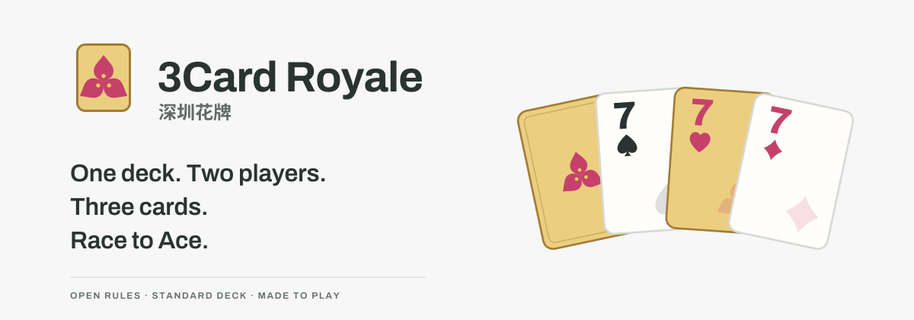

# 深圳花牌 · 3Card Royale

**简体中文** · [English](README.md)



**一副牌，两个人，三张牌，打出花。**

深圳花牌（3Card Royale，aka Shenzhen Flower Cards）是一款来自深圳的双人扑克牌游戏。组合牌型，把伤牌变成选择，从 2 打到 A。一副普通 52 张扑克牌就能玩，也可以在浏览器里挑战 AI。

[**开始玩 ↗**](https://lucienzhu.github.io/3card-royale/?lang=zh-CN) · [怎么玩](https://lucienzhu.github.io/3card-royale/about.html?lang=zh-CN) · [视觉](https://lucienzhu.github.io/3card-royale/brand.html?lang=zh-CN) · [AI 竞技场](https://lucienzhu.github.io/3card-royale/arena.html?lang=zh-CN)

网页支持[简体中文](https://lucienzhu.github.io/3card-royale/?lang=zh-CN)、[English](https://lucienzhu.github.io/3card-royale/?lang=en)、[日本語](https://lucienzhu.github.io/3card-royale/?lang=ja)、[한국어](https://lucienzhu.github.io/3card-royale/?lang=ko)和[Español](https://lucienzhu.github.io/3card-royale/?lang=es)。网站、新手引导、完整规则和分享图随语言切换。

## 玩法

1. 八张手牌起步，从手牌与公开伤牌中选三张出牌；四张、五张须组成炸弹。
2. 进攻赢了打伤害，防守赢了获得换牌机会，每次都可以放弃。完全相同则无效果。
3. 交换攻守；双方各进攻一次后，保留余牌，补手牌到八张。

五伤输局。赢家按最终伤牌差升级。到 A 后，赢下自己打级的 A 局，才赢下整场。打出伤牌后会补回，不能借此回血。每局双方共用一张红桃花牌。

[标准规则 1.0.0](docs/RULES.zh-CN.md) · [打印规则](https://lucienzhu.github.io/3card-royale/about.html?lang=zh-CN#learn)

试玩包含一次进攻与防守练习、首局提示、划牌选择、回放和 PNG 分享。单局回顾与整场开花采用不同结算画面；种子与记录支持复现对局。

## AI 与研究

在 **设置 → 偏好 → AI 对手** 中选择。新玩家默认 Easy；NN AI 在本地 Worker 中运行自回归模型，竞技场 AI 还可加载整手评分模型。Godlike 能看见对手当前手牌，不参加公开信息天梯。

纯代码、整手评分、自回归共用**同一动作协议**：固定实体牌 ID、完整语义动作，以及可选的六 token 序列。GameCore 校验后一次执行完整动作；模型结构由策略自行选择。

| 模型 | 隐藏层 | 参数 | ONNX | 对 Code AI 胜率 |
| --- | --- | ---: | ---: | ---: |
| 整手评分 | 256 → 128 | 137,729 | 0.55 MB | 42.6% |
| 自回归 | 256 → 128 | 228,929 | 0.92 MB | 23.9% |

两者都以 SDK Code AI 为老师，分别使用一万局数据进行 PyTorch 模仿学习，记录 TensorBoard 曲线并导出 ONNX。SDK Code AI 是冻结训练教师，网页 Code AI 是困难对手。表中每组 1,000 小局，使用相同种子、交换座位并平衡先攻。当前模型尚未通过奖励训练；难度名称不等于实测棋力排序。

- [动作协议与 Gym](docs/ACTIONS.md) · [RL 环境](docs/RL.zh-CN.md)
- [模型与证据](docs/MODEL.zh-CN.md) · [完整评测](docs/experiments/complete-baseline/README.md)
- 训练：[整手评分](training/README.md) · [自回归](training/structured/README.md)
- [提交 JS 或 ONNX 策略](policies/README.md) · [评分方法](arena/README.md)

竞技场策略记录 GitHub 作者与固定文件校验值。本地验证和 PR CI 检查能否合法对战；发布时对待评分策略运行三组固定对手，自动更新天梯和网页。每个新提交需要 60 评分小局及四局验证。

## 本地运行

网站为静态文件，已包含推理运行时。

```sh
python3 -m http.server 8000 --bind 127.0.0.1
# 打开 http://127.0.0.1:8000/about.html?lang=zh-CN
npm ci
npm test
```

SDK 包含 JavaScript/TypeScript、Python、Rust 和 C++17；Gym 支持小局和整场任务。参见 [SDK 安装](docs/SDK.md)、[参与开发](docs/CONTRIBUTING.md)和[对局验证](docs/GAMETEST.md)。

## 设计与许可

三角梅、红花与电路板绿构成深圳花牌的视觉。原版三瓣花、金底牌与玩家标识在游戏、网站和导出图片中共用标准素材。

[设计规范](docs/DESIGN.zh-CN.md) · [组件](https://lucienzhu.github.io/3card-royale/design-system.html?lang=zh-CN) · [反馈](https://github.com/lucienzhu/3card-royale/issues/new/choose)

产品版本 1.2 与标准规则 1.0.0 分别管理。代码、规则和原创视觉素材使用 [MIT 许可](LICENSE)。
