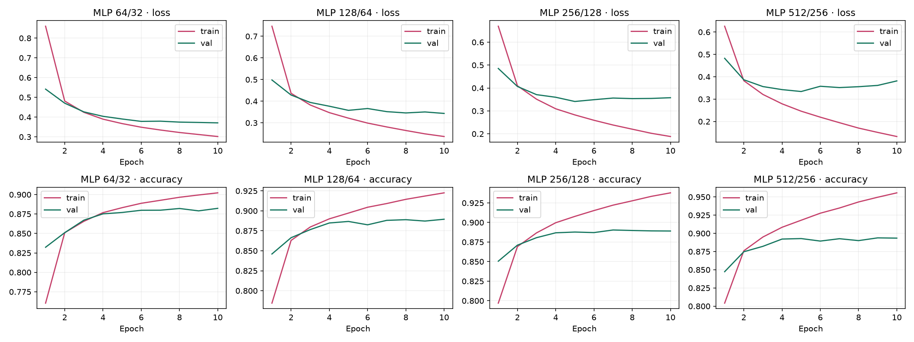

# NN Policy v1 · 2026-10-24

Experimental branch: `codex/nn-policy-ai`. Game rules remain 1.0.0.
Source base: `947d5f2e61ffa5d74b10d6ac87b5bc7567088fbc`.

## Dataset

Two SDK Code AIs played **10,000 complete single-game episodes** through the
Gymnasium environment. Both seats were recorded: **252,859 decisions** and
**19,789,638 legal candidate rows**. No truncated episode retries were needed.
Collection seed: 20261024. Collection took 169.47 seconds on the local machine.

One third of games start at level 2, one third at random levels, and one third
with a player on Ace. First movers alternate. These are environment reset
options, not rule changes. Test matches use normal level-2 starts.

Split by whole game ID: 8,000 training games / 202,325 decisions; 1,000 validation
games / 24,950 decisions; 1,000 test games / 25,584 decisions. Both seats stay in
the same split. IDs modulo ten select validation (0), test (1), and training
(2–9). There is no decision-level split across the same game.

Compressed shards use float16 storage; model operations and ONNX weights are
float32. Public current-state features include hand, wounds, visible opponent
wounds, discard, current played cards and game metadata. Hidden hands, deck
order, seed, RNG and historical events are excluded.

## Model and training

`observation (336) + legal candidate (72) → MLP W → W/2 → score`

Two ReLU hidden layers and a scalar output. Shared scoring supports variable
legal action counts; illegal/padded actions are masked out. Features retain the
existing environment's public card evaluation fields. There is no recurrence,
look-ahead search or reward learning.

PyTorch, AdamW (lr 0.001, weight decay 0.0001), batch 128, ten epochs, CPU with four
threads. Each size starts with seed 20261024. The checkpoint with the lowest
validation cross-entropy is exported to FP32 ONNX opset 17. Test metrics are
reported once after checkpoint selection. Accuracy is agreement with Code AI's
chosen action, not game win rate; equivalent tied actions can count as errors.

Numeric summaries are in [training.json](training.json), per-epoch JSON files,
and the original [TensorBoard events](tensorboard/). Start TensorBoard against
this folder's `tensorboard/` directory to inspect the saved runs without
regenerating samples.

## Evaluation and profiling

[evaluation.json](evaluation.json) contains 1,000 independent seeded games per
model against Code AI, with equal seat counts and balanced first movers. Paired
seeds swap the NN's seat. These are held-out game seeds, not training samples.
The reported Wilson intervals treat individual games as trials; paired-game
correlation is not accounted for, so small differences are not evidence of a
strength improvement.

[browser-profile.json](browser-profile.json) records Chrome on this Mac, WASM,
one thread, FP32. Each candidate count gets three warmups and 100 timed runs.
56, 220 and 512 candidates cover ordinary and large action lists. The large
lists repeat public candidate rows to isolate inference cost. Timing excludes
network download, feature extraction and the UI's 400 ms thinking delay. Cold
load includes local file access and session initialization, not a mobile-network
benchmark. No physical iPhone measurement has been made.

The browser harness also compares all model logits and chosen actions on twelve
real positions with PyTorch/ONNX. Python/JavaScript input and teacher parity
checks cover 55,584 values. See `tests/nn-policy.cjs` and `training/parity.py`.

## Playing and reliability

Settings → Preferences offers **Code AI** and **NN AI**. Code AI uses the same
visible-information SDK policy used to generate samples. NN AI currently uses
the requested 256 model. Unsupported older rules keep their original policy.

Models and runtime are hosted as static files from the same origin. Inference
runs in a Web Worker. On load failure, timeout or invalid logits, the game falls
back to Code AI and shows a short status message. Failed loads back off for a
minute; selecting NN AI again retries immediately. Switching modes or replacing
a game invalidates in-flight results, preventing stale actions.

The model is below 5 MB; the separately cached runtime is about 14 MB raw. First
NN selection therefore downloads more than the model size alone.

See [reproduction instructions](../../../training/README.md). The independent
local experiment folder retains raw data and checkpoints; Git contains the
pipeline, deployed weights, metrics, curves and TensorBoard events. Main is not
merged by this experiment.

## Comparison

See [the measured results table](RESULTS.md). In collected data, attacks have a
median of 84 candidates and defenses 56; both have a p95 of 220. The observed
maximum is 227. The 512-candidate benchmark is a synthetic capacity stress test.

The 512/256 model is 1,365,463 bytes and improves held-out action agreement by
0.21 percentage points over 256/128. It wins 450/1,000 games against Code AI,
versus 462/1,000 for 256/128. This evaluation does not demonstrate a strength gain.
Its browser p95 at 220 candidates is 2.2 ms versus 0.8 ms for 256. Both remain
small and fast on this desktop; the experiment keeps 256 active and retains the
512 weights for comparison. The smaller 128 baseline is also competitive and
can be republished from the saved artifacts when download size is the priority.
